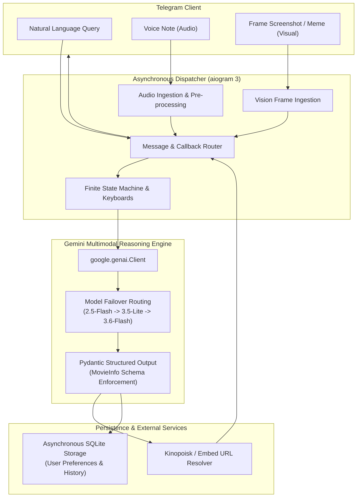

# CinemaAI: Multimodal Conversational Discovery Engine

[](https://python.org)
[](https://github.com/aiogram/aiogram)
[](https://ai.google.dev/)
[](LICENSE)

**CinemaAI** is an asynchronous, multimodal Telegram bot that serves as an intelligent film discovery and media recommendation agent. Built upon **aiogram 3** and the official **Google GenAI SDK** (`google-genai`), CinemaAI accepts unstructured text queries, voice audio notes, and screenshot image frames, extracting structured semantic metadata to surface curated cinematic recommendations and player embeds in real time.

---

## Architectural Overview

The application is structured around non-blocking event loops, type-safe data contracts, and resilient model failover:



---

## Key Systems Engineering Highlights

### 1. Schema-Enforced Structured LLM Output
Rather than parsing fragile unstructured markdown from language model completions, CinemaAI enforces strict schema compliance using **Pydantic**:
- Extracts normalized entities: `title_ru`, `title_orig`, `year`, `kinopoisk_id`, `rating_kp`, `rating_imdb`, `genres`, `director`, `actors`, and `why_recommended`.
- Guarantees deterministic parsing across model responses, preventing UI render crashes.

### 2. Multimodal Perception Pipeline
- **Voice Ingestion:** Streams `.ogg` / Opus voice notes from Telegram directly into Gemini's native multimodal audio ingestion pipeline without third-party speech-to-text latency.
- **Vision Recognition:** Ingests cinematic frames, stills, or movie memes, performing zero-shot visual similarity and actor identification to reconstruct movie titles from visual scenes alone.

### 3. Graceful Model Degradation & Resilience
- Implements an automated failover hierarchy (`MODELS_FALLBACK`) across Gemini model tiers to handle regional quota spikes or API rate-limiting dynamically without dropping user sessions.

### 4. Asynchronous Local State Management
- Utilizes SQLite (`database.py`) to maintain localized session states, historical recommendation tracking (preventing duplicate suggestions), and multi-lingual UI settings (Russian and Uzbek).

---

## Directory Structure

```text
cinema_bot/
├── main.py                   # Async entrypoint & aiogram router orchestration
├── ai_service.py             # Google GenAI integration & Pydantic schema validation
├── config.py                 # Typed configuration & environment loading
├── database.py               # SQLite asynchronous persistence & schema migrations
├── keyboards.py              # Inline and Reply keyboard builders
├── locales.py                # Multi-language dictionary (RU / UZ)
├── player_service.py         # Media URL routing & streaming player embeds
├── requirements.txt          # Python dependencies
├── .env.example              # Environment configuration template
└── run.bat                   # Windows batch execution script
```

---

## Getting Started

### 1. Installation
Clone the repository and set up a virtual environment:
```bash
git clone https://github.com/abdurahmongive-web/cinema_bot.git
cd cinema_bot

python -m venv .venv
source .venv/bin/activate  # On Windows: .venv\Scripts\activate
pip install -r requirements.txt
```

### 2. Configuration
Copy `.env.example` to `.env` and provide your API keys:
```bash
cp .env.example .env
```

Edit `.env`:
```env
BOT_TOKEN=your_telegram_bot_token_from_botfather
GEMINI_API_KEY=your_gemini_api_key_from_google_ai_studio
GEMINI_MODEL=gemini-2.5-flash
```

### 3. Execution
```bash
python main.py
```

---

## Author

**Abdurahmon**  
High School Systems Builder & Researcher — Tashkent, Uzbekistan  
- GitHub: [@abdurahmongive-web](https://github.com/abdurahmongive-web)  
- Email: `abdurahmongive@gmail.com`
